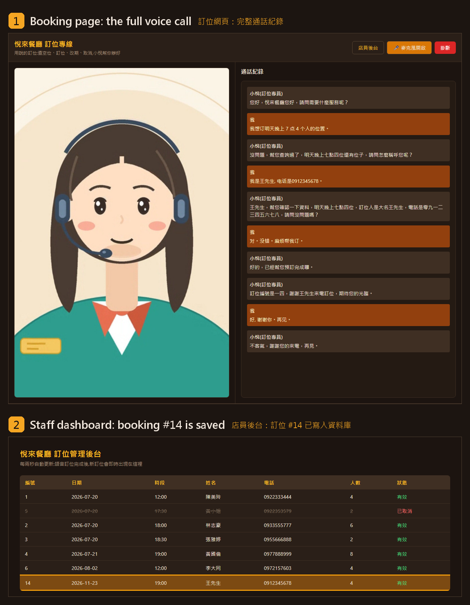
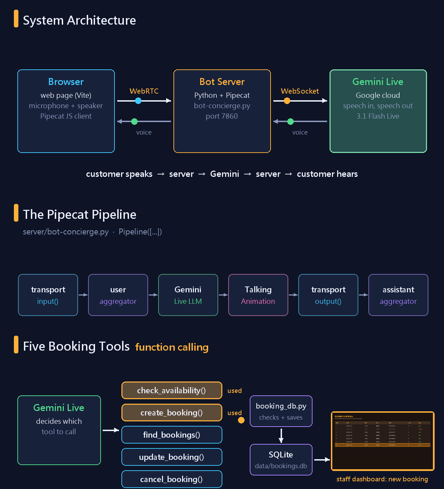

**English** | [繁體中文](README.zh-TW.md)

# Yuelai Restaurant Voice Booking Agent (Pipecat + Gemini Live + Function Calling)

> A voice booking assistant for a restaurant: customers book, check, change, or cancel a table just by talking, and every booking is saved into a real database for the staff.

This is a **voice assistant that does real work**, built with [Pipecat](https://github.com/pipecat-ai/pipecat).
You open a web page, use your microphone to "call" Yuelai Restaurant (悅來餐廳), and talk with
Xiao Yue (小悅), the booking assistant. By voice, you can **check free tables, book a table,
look up a booking, change a booking, and cancel a booking**. Every change is written into a real
SQLite database through Gemini Live **function calling**, and you can see it at once in the staff dashboard.

The assistant speaks Taiwanese Mandarin. This project is based on the sibling project
[`Pipecat-interview-coach`](../Pipecat-interview-coach) (a voice mock interviewer).
That project shows how to give the bot a role; this project shows how the bot can **call tools to get work done**.

## Demo video

[](https://youtu.be/zbwwdro6uKA)

The video (3 min 20 s) has two parts: a full booking call (about 1 minute), and then an English explanation
of the architecture and the tools. In the video, the customer's voice is synthesized speech (edge-tts).
A copy of the video is also in this repository: [docs/demo/restaurant-agent-demo.mp4](docs/demo/restaurant-agent-demo.mp4).

## Screenshot



The top part is the booking page after a real call: Xiao Yue's lines and the customer's lines (「我」, "me")
are shown in order, from the greeting to goodbye. The bottom part is the staff dashboard: booking #14,
made by voice in this call, is highlighted. The customer's lines are written by Gemini's speech
recognition, so they may appear in Simplified Chinese.

## The problem and who it is for

| | |
|---|---|
| The situation | At busy hours, the restaurant phone keeps ringing for bookings, while the staff are serving guests. |
| Who uses it | Customers who want to book a table, and the restaurant staff who check the bookings. |
| The problem today | A person must answer every call, check the booking book, and write the booking down by hand. Calls are missed and mistakes happen. |
| The goal | A customer can book, check, change, or cancel a table in one short voice call, at any time, and the booking is saved for the staff at once. |
| Why a general AI chat cannot do it as well | A chat AI does not know the restaurant's free tables and cannot save a booking. Here, the model calls tools that read and write the real booking database. |

## How does it "do work"?

```
You say: "I want a table for four, tomorrow at 7 pm."
  → Gemini Live decides it must check, and calls the tool check_availability("2026-07-20", "19:00", 4)
  → Python really queries SQLite → the result goes back to the model
  → Xiao Yue: "We have a table tomorrow at 7 pm. May I have your name and phone number?"
  → After the customer confirms, it calls create_booking(...) → a new booking is saved
  → The staff dashboard (http://localhost:7861/admin) shows it within two seconds
```

There are five tools. They are direct functions in `server/bot-concierge.py`, and the real logic is in `server/booking_db.py`:

| Tool | What it does |
|---|---|
| `check_availability` | Checks if a time slot on a date has free seats; if it is full, it returns other free time slots |
| `create_booking` | Creates a booking (called only after the assistant repeats the details and the customer confirms) |
| `find_bookings` | Finds active bookings by phone number |
| `update_booking` | Changes the date, time, or party size (checks the new slot's capacity first) |
| `cancel_booking` | Cancels a booking and frees the seats |

Opening rules: lunch 11:00–13:30 and dinner 17:00–20:30 (last booking times, in 30-minute slots).
Each time slot holds at most 20 guests.

## Architecture



```
Browser client (5173)  ←WebRTC→  bot server (7860, Pipecat + Gemini Live)
                                     │ function calling
                                     ▼
                              booking_db.py ←→ server/data/bookings.db (SQLite)
                                     ▲
Staff browser  ←HTTP→  admin server (7861, FastAPI /admin + /api/bookings)
```

- **Browser client**: a Vite web page with the Pipecat JS client. It sends your voice and plays the bot's voice and video.
- **Bot server**: Python + Pipecat. It passes the audio to Gemini Live and runs the tools.
- **Gemini Live**: Google's speech-to-speech model. It listens, decides when to call a tool, and speaks the reply.
- **Admin server**: a FastAPI page that shows all bookings.

### Listen, think, speak

| Step | What happens | Model or service |
|---|---|---|
| Listen | The customer's voice goes to the server; the system finds when the customer starts and stops talking | WebRTC (SmallWebRTC), Silero VAD + Smart Turn |
| Think | The model understands the request and calls a booking tool when it needs data | Gemini Live (`gemini-3.1-flash-live-preview`) + function calling |
| Speak | The model speaks the reply directly (no separate text-to-speech) | Gemini Live, voice `Kore` |
| Screen | The page plays the voice, shows the conversation as text, and shows a talking character | Vite web page + Pipecat JS client |

### Technologies and frameworks

| | What is used |
|---|---|
| Language | Python 3.11+ (server), JavaScript (web page) |
| Speech model and API | Gemini Live API (speech in, speech out, with function calling) |
| Agent framework | Pipecat 1.5 (pipeline, transports, function calling) |
| User interface | Vite web page with the Pipecat JS client; FastAPI staff dashboard |
| Other libraries and tools | SQLite, Silero VAD, Smart Turn, uv, pytest |
| Where it runs | A Windows computer (localhost); only the Gemini model runs in Google's cloud |

### The hardest part

The hardest part is making sure a booking is **real and correct**, not just a nice sentence.
A language model can say "Your table is booked" without saving anything, or turn "tomorrow" into the wrong date.
To stop this, the system prompt has strict rules: always call a tool, never pretend, and repeat all details to the
customer before calling `create_booking`. The server puts today's date into the prompt at the start of each call,
so words like "tomorrow" and "next Friday" become the right date. Finally, `booking_db.py` checks every date, time,
and party size; when something is wrong, the tool returns an error message that the assistant explains to the customer.

## Results

- **What works well**: A full booking call (check, give name and phone, confirm, save) works in about one minute,
  and the booking appears in the staff dashboard within two seconds.
- **Speed**: In our test calls, the reply started about 0.5–1.2 s after the customer finished speaking.
- **What does not work well yet**:
  - The customer's words are written by Gemini's speech recognition, which often uses Simplified Chinese.
  - If the customer pauses in the middle of a sentence, the assistant may start to answer too early.
  - With the preview model, the assistant's voice sometimes became lower for a moment.
- **What we would add next**: convert the customer's text to Traditional Chinese (for example with OpenCC),
  test the newer `gemini-3.8-live` model, connect a real phone line (Pipecat supports Twilio and other telephone
  transports), and add a login to the staff dashboard.

## Requirements

- **Windows** (the batch files are written for Windows)
- **Python 3.11+** and [**uv**](https://docs.astral.sh/uv/)
- **Node.js 18+**
- **Google Gemini API key**: <https://aistudio.google.com/apikey>

You need **only one key**: `GOOGLE_API_KEY`. No other service (Daily, ElevenLabs, Deepgram, OpenAI)
is used, because the browser connects to the server directly with SmallWebRTC.

## Setup

1. Copy `server/env.example` to `server/.env`, then set `GOOGLE_API_KEY=your-key`.
   (**Never commit `.env` to git.**)
2. Install the dependencies:

   ```powershell
   cd server
   uv sync
   cd ..\client
   npm install
   ```

## Run

```powershell
.\start.bat
```

This opens three windows:

- **Booking web page** → <http://localhost:5173> (click 「撥打訂位專線」 to start the call)
- **Staff dashboard** → <http://localhost:7861/admin> (watch bookings appear in the database)
- Bot server API → <http://localhost:7860>

Put the booking page and the staff dashboard side by side. Then you can see each booking appear
right after you make it by voice. To stop everything: `.\stop.bat`.

On the first start, the server creates `server/data/bookings.db` and adds a few sample bookings.
To reset the data, stop the services and delete that file.

## Tests

The booking data layer has unit tests (capacity, full slots, changes, cancellations that free seats, and more):

```powershell
cd server
uv run pytest
```

## Things to try

1. "我想訂明天晚上七點，四個人" (a table for four, tomorrow at 7 pm) → finish the booking and listen to Xiao Yue repeat the details.
2. Open the staff dashboard and see the new booking.
3. "我想查一下我的訂位" (I want to check my booking) → give your phone number.
4. "幫我改到八點" (change it to 8 pm) → the dashboard updates.
5. "取消好了" (please cancel it) → the dashboard shows it as cancelled.
6. Try a full slot: fill one time slot, then book again. Xiao Yue will suggest other times.

## How to customize

- **Role, call flow, and rules**: edit `server/prompts/system_prompt.md`.
  The server reads this file at the start of each call, and fills in today's date for `{{TODAY}}` and `{{WEEKDAY}}`.
- **Opening hours and capacity**: the constants at the top of `server/booking_db.py`.
- **Model and voice**: set them in `server/.env`:

  ```
  GEMINI_LIVE_MODEL=models/gemini-3.8-live
  GEMINI_LIVE_VOICE=Kore
  ```

  `server/env.example` uses `gemini-3.8-live`. If `GEMINI_LIVE_MODEL` is not set, the code uses
  `models/gemini-3.1-flash-live-preview` (the model used in the demo video). Other voices: Aoede, Charon, Fenrir, Puck.

## Further reading

A full tutorial (in Chinese) covers phone booking, the system architecture, and a walkthrough of this
project's code: [docs/tutorial/語音客服系統教學.md](docs/tutorial/語音客服系統教學.md)

## How AI tools were used

| | |
|---|---|
| Which AI tools | Claude Code (Claude models) |
| Where | In the terminal and VS Code, working directly on this repository |
| What for | Writing and testing the code, the system prompt, this README, the screenshots, and the demo video (the call recording, the editing, and the English narration) |

## References and credits

- **Framework**: [Pipecat](https://github.com/pipecat-ai/pipecat) and its [documentation](https://docs.pipecat.ai/)
- **Documentation**: [Gemini Live API](https://ai.google.dev/gemini-api/docs/live)
- **Models and services**: Google Gemini Live (`gemini-3.1-flash-live-preview`); [Silero VAD](https://github.com/snakers4/silero-vad) and [Smart Turn](https://github.com/pipecat-ai/smart-turn) for turn detection
- **Data**: the restaurant, its opening hours, and the sample bookings are made up for this demo
- **Voices**: the assistant's voice is the Gemini Live voice `Kore`. In the demo video, the customer's voice is synthesized with [edge-tts](https://github.com/rany2/edge-tts) (`zh-TW-YunJheNeural`), and the English narration with [Kokoro](https://huggingface.co/hexgrad/Kokoro-82M)
- **Code from others**: the web client was created from the Pipecat CLI template (`pipecat-cli`); `server/bot-concierge.py` starts from a Pipecat example (Copyright Daily, BSD 2-Clause License); the project is adapted from the sibling project `Pipecat-interview-coach`

## ⚠️ Security notes

`server/.env` holds a real API key, so `.gitignore` must exclude `.env`.
The staff dashboard has no login. Use it only as a local demo.
