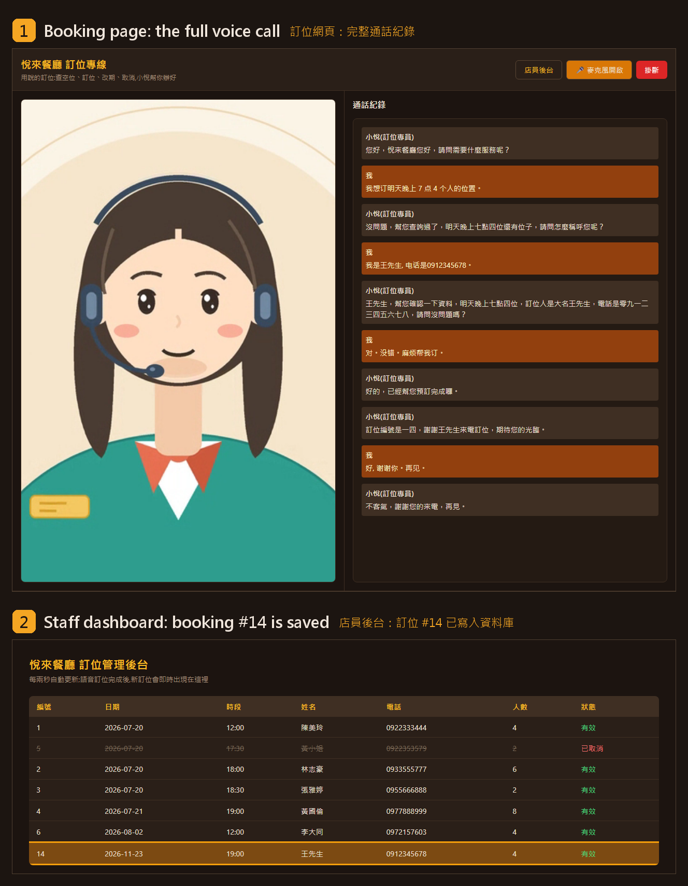
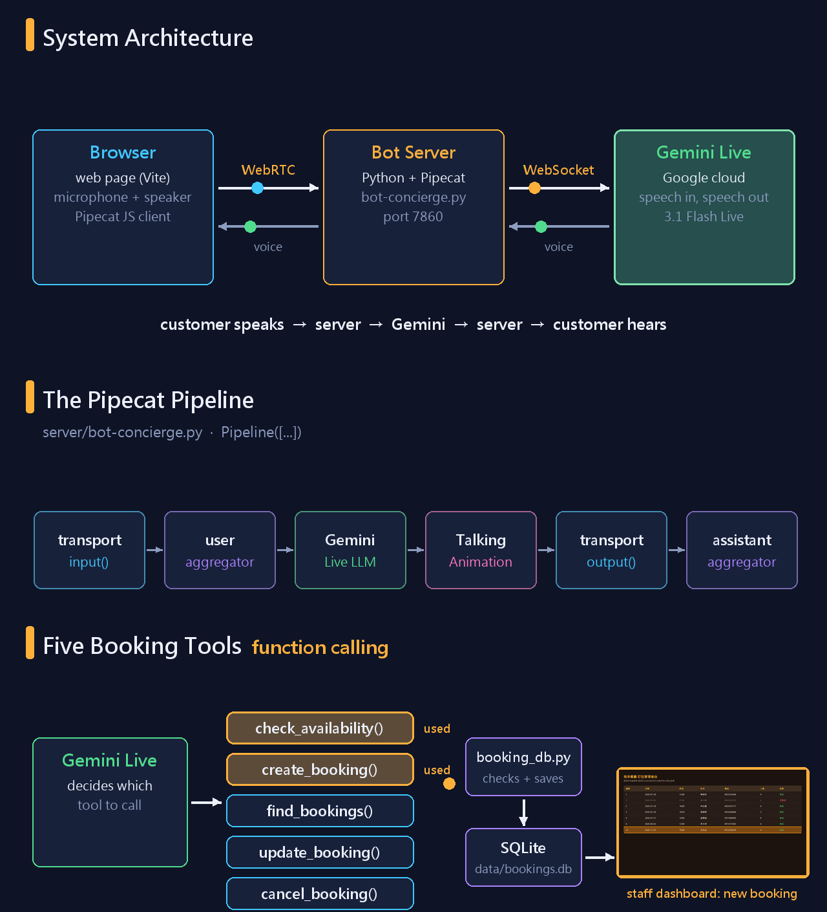

[English](README.md) | **繁體中文**

# 悅來餐廳 語音訂位客服(Pipecat + Gemini Live + Function Calling)

> 餐廳的語音訂位助理：客人用說的就能訂位、查詢、改期或取消，每一筆訂位都會真實寫入資料庫，讓店員即時看到。

用 [Pipecat](https://github.com/pipecat-ai/pipecat) 搭建的**會做事的語音助理**:在瀏覽器用麥克風打「電話」給悅來餐廳的訂位專員「小悅」,用說的完成**查空位、訂位、查詢、改期、取消**。所有異動透過 Gemini Live 的 **function calling** 真實寫入 SQLite 資料庫,並可在店員管理後台即時看到。

本專案基於同層的 [`Pipecat-interview-coach`](../Pipecat-interview-coach)(語音模擬面試官)改造;那個專案展示「角色塑造」,這個專案展示「工具呼叫做事」。

## 展示影片

[](https://youtu.be/zbwwdro6uKA)

影片長 3 分 20 秒,分成兩段:前段是一通完整的訂位電話(約 1 分鐘),後段是英文旁白的架構與工具說明。影片中客人的聲音是語音合成(edge-tts)。專案裡也留有一份影片檔:[docs/demo/restaurant-agent-demo.mp4](docs/demo/restaurant-agent-demo.mp4)。

## 系統畫面



上半部是一通實際通話結束後的訂位網頁：從小悅接起電話、客人（「我」）說明需求、覆誦確認，到完成訂位與道別，整段對話都在通話紀錄裡。下半部是店員後台，標示出這通電話用語音建立的第 14 號訂位。客人說的話是由 Gemini 的語音辨識轉成文字，所以可能會以簡體字顯示。

## 要解決的問題與使用對象

| | |
|---|---|
| 情境 | 用餐尖峰時段,訂位電話一直響,店員卻正忙著招呼客人。 |
| 使用者 | 想訂位的客人,以及要查看訂位的餐廳店員。 |
| 現在的問題 | 每通電話都要有人接、翻訂位簿、手寫登記,容易漏接電話,也容易記錯。 |
| 目標 | 客人隨時打一通簡短的語音電話,就能完成訂位、查詢、改期或取消,訂位立刻寫進資料庫給店員看。 |
| 系統的優點 | 每通電話都能立刻接聽,查的是真實的空位,訂位直接寫進資料庫給店員看,不需要人工手寫登記。模型透過工具讀寫真實的訂位資料庫,不會憑空猜測。 |

## 它怎麼「做事」?

```
你說「我想訂明天晚上七點,四個人」
  → Gemini Live 判斷需要查詢,發出工具呼叫 check_availability("2026-07-20", "19:00", 4)
  → Python 真的去查 SQLite → 回傳結果給模型
  → 小悅:「明天晚上七點還有位子喔,請問怎麼稱呼?方便留個電話嗎?」
  → 確認後呼叫 create_booking(...) → 資料庫多一筆訂位
  → 店員後台 (http://localhost:7861/admin) 兩秒內就會顯示這筆訂位
```

五個工具(`server/bot-concierge.py` 內的 direct functions,實作在 `server/booking_db.py`):

| 工具 | 功能 |
|---|---|
| `check_availability` | 查某日某時段是否有位;滿位回傳替代時段 |
| `create_booking` | 建立訂位(覆誦確認後才呼叫) |
| `find_bookings` | 用電話號碼查有效訂位 |
| `update_booking` | 改期/改時段/改人數(先驗新時段容量) |
| `cancel_booking` | 取消訂位,容量釋出 |

營業規則:午餐 11:00–13:30、晚餐 17:00–20:30(30 分鐘一時段),每時段 20 人。

## 架構



```
瀏覽器 client (5173)  ←WebRTC→  bot server (7860, Pipecat + Gemini Live)
                                     │ function calling
                                     ▼
                              booking_db.py ←→ server/data/bookings.db (SQLite)
                                     ▲
店員瀏覽器  ←HTTP→  admin server (7861, FastAPI /admin + /api/bookings)
```

### 聽、想、說

| 步驟 | 做什麼 | 使用的模型或服務 |
|---|---|---|
| 聽 | 客人的聲音傳到伺服器,系統判斷客人什麼時候開始、什麼時候講完 | WebRTC(SmallWebRTC)、Silero VAD + Smart Turn |
| 想 | 模型理解客人的需求,需要資料時呼叫訂位工具 | Gemini Live(`gemini-3.1-flash-live-preview`)+ function calling |
| 說 | 模型直接說出回答,不需要另外的語音合成 | Gemini Live,聲音 `Kore` |
| 畫面 | 網頁播放聲音、以文字顯示通話紀錄,並顯示會說話的角色動畫 | Vite 網頁 + Pipecat JS client |

### 使用的技術與框架

| | 使用的工具 |
|---|---|
| 程式語言 | Python 3.11+(伺服器)、JavaScript(網頁) |
| 語音模型與 API | Gemini Live API(語音輸入、語音輸出,支援 function calling) |
| Agent 框架 | Pipecat 1.5(處理流程、連線傳輸、函式呼叫) |
| 使用者介面 | Vite 網頁 + Pipecat JS client;FastAPI 店員後台 |
| 其他函式庫與工具 | SQLite、Silero VAD、Smart Turn、uv、pytest |
| 執行環境 | Windows 電腦(localhost);只有 Gemini 模型在 Google 雲端執行 |

### 最困難的部分

最困難的是確保訂位是**真的、而且正確的**,而不只是一句好聽的回答。語言模型可能沒有存下任何資料,就說「已經幫您訂好了」,也可能把「明天」換算成錯誤的日期。為了避免這些問題,系統提示詞訂了嚴格的規則:一定要呼叫工具、絕對不可以假裝,而且呼叫 `create_booking` 之前要先跟客人覆誦所有資料。伺服器每次通話開始時會把當天日期放進提示詞,讓「明天」「下週五」能換算成正確的日期。最後,`booking_db.py` 會檢查每一個日期、時間和人數;資料有誤時,工具會回傳錯誤訊息,由小悅用口語向客人說明。

## 成果

- **做得好的地方**:一通完整的訂位電話(查空位、留姓名電話、確認、寫入)大約一分鐘就能完成,新訂位兩秒內就會出現在店員後台。
- **速度**:在我們的測試通話中,客人講完話後大約 0.5 到 1.2 秒,小悅就開始回答。
- **還做得不夠好的地方**:
  - 客人說的話是 Gemini 的語音辨識轉成的文字,常常是簡體字。
  - 客人如果在句子中間停頓,小悅有時會太早開始回答。
  - 使用預覽版模型時,小悅的聲音偶爾會短暫變低。
- **接下來想加的功能**:把客人的文字轉成繁體中文(例如用 OpenCC)、測試較新的 `gemini-3.8-live` 模型、接上真正的電話線路(Pipecat 支援 Twilio 等電話傳輸方式),以及幫店員後台加上登入功能。

## 環境需求

- **Windows**(批次檔為 Windows 寫的)
- **Python 3.11+** 與 [**uv**](https://docs.astral.sh/uv/)
- **Node.js 18+**
- **Google Gemini API Key**:<https://aistudio.google.com/apikey>

整個系統**只需要一把金鑰** `GOOGLE_API_KEY`。瀏覽器透過 SmallWebRTC 直接連到本機伺服器,所以不需要 Daily、ElevenLabs、Deepgram、OpenAI 等其他服務。

## 設定與安裝

1. 把 `server/env.example` 複製成 `server/.env`,填入 `GOOGLE_API_KEY=你的金鑰`(**勿進版控**)。
2. 安裝依賴:

   ```powershell
   cd server
   uv sync
   cd ..\client
   npm install
   ```

## 執行

```powershell
.\start.bat
```

會開三個視窗:

- **訂位專線網頁** → <http://localhost:5173>(按「撥打訂位專線」開始)
- **店員管理後台** → <http://localhost:7861/admin>(即時看訂位進資料庫)
- bot 後端 API → <http://localhost:7860>

建議把訂位網頁與管理後台並排開,語音訂完位立刻看到資料出現。停止:`.\stop.bat`。

首次啟動會自動建立 `server/data/bookings.db` 並塞入幾筆示範訂位。想重置資料,關掉服務後刪除該檔即可。

## 測試

訂位資料層有完整單元測試(容量、滿位、改期、取消釋出容量等):

```powershell
cd server
uv run pytest
```

## 試用劇本建議

1. 「我想訂明天晚上七點,四個人」→ 走完訂位流程,聽小悅覆誦確認。
2. 到管理後台看新訂位出現。
3. 「我想查一下我的訂位」→ 報電話號碼。
4. 「幫我改到八點」→ 後台同步更新。
5. 「取消好了」→ 後台顯示已取消。
6. 試試客滿情境:同時段訂到滿,再訂一次聽小悅推薦替代時段。

## 想調整?

- **人設/流程/規則話術**:`server/prompts/system_prompt.md`。每次通話開始時讀取,並把 `{{TODAY}}`、`{{WEEKDAY}}` 換成當天日期與星期。
- **營業時段/容量**:`server/booking_db.py` 頂部常數。
- **模型與聲音**:在 `server/.env` 設定:

  ```
  GEMINI_LIVE_MODEL=models/gemini-3.8-live
  GEMINI_LIVE_VOICE=Kore
  ```

  `server/env.example` 預設填的是 `gemini-3.8-live`;沒有設定 `GEMINI_LIVE_MODEL` 時,程式會用 `models/gemini-3.1-flash-live-preview`(展示影片用的就是這個)。聲音可換 Aoede、Charon、Fenrir、Puck。

## 延伸教學

從電話訂位、交換機架構到這個專案的完整程式碼解析：[docs/tutorial/語音客服系統教學.md](docs/tutorial/語音客服系統教學.md)

## 使用的 AI 工具

Claude Code(Claude 模型)。

## 參考資料與來源

- **框架**:[Pipecat](https://github.com/pipecat-ai/pipecat) 與其[官方文件](https://docs.pipecat.ai/)
- **文件**:[Gemini Live API](https://ai.google.dev/gemini-api/docs/live)
- **模型與服務**:Google Gemini Live(`gemini-3.1-flash-live-preview`);判斷說話開始與結束用 [Silero VAD](https://github.com/snakers4/silero-vad) 與 [Smart Turn](https://github.com/pipecat-ai/smart-turn)
- **資料**:餐廳、營業時間與示範訂位都是為了這個展示虛構的
- **聲音**:小悅的聲音是 Gemini Live 的 `Kore`。展示影片中,客人的聲音用 [edge-tts](https://github.com/rany2/edge-tts)(`zh-TW-YunJheNeural`)合成,英文旁白用 [Kokoro](https://huggingface.co/hexgrad/Kokoro-82M) 合成
- **引用他人的程式**:網頁前端由 Pipecat CLI 範本(`pipecat-cli`)產生;`server/bot-concierge.py` 以 Pipecat 範例為基礎(Copyright Daily,BSD 2-Clause 授權);整個專案改編自同層的 `Pipecat-interview-coach`

## ⚠️ 安全性提醒

`server/.env` 含真實 API key,`.gitignore` 需排除 `.env`;管理後台無身分驗證,僅供本機 demo。
