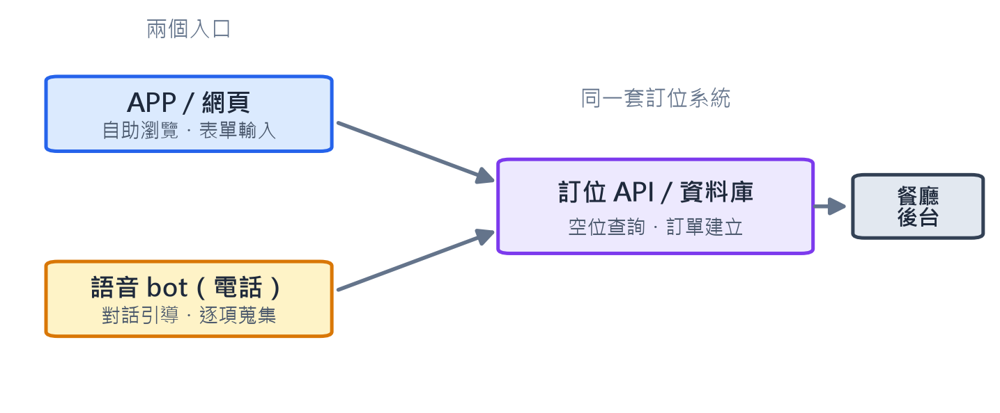
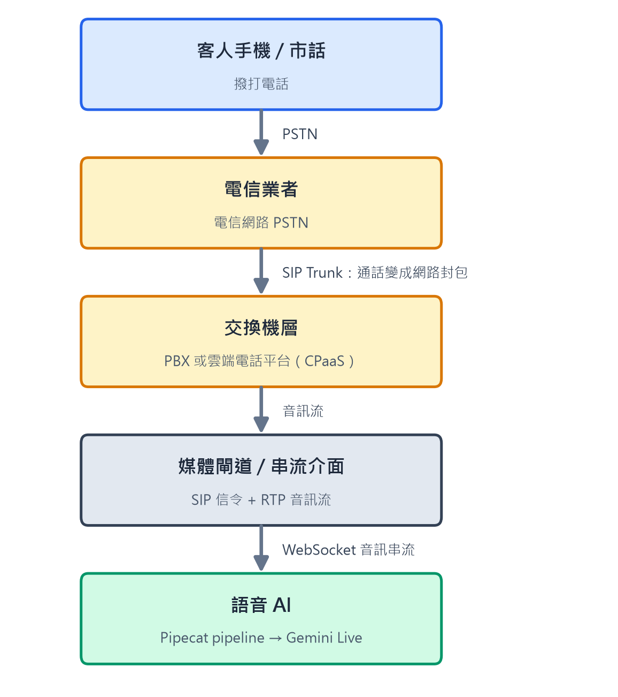
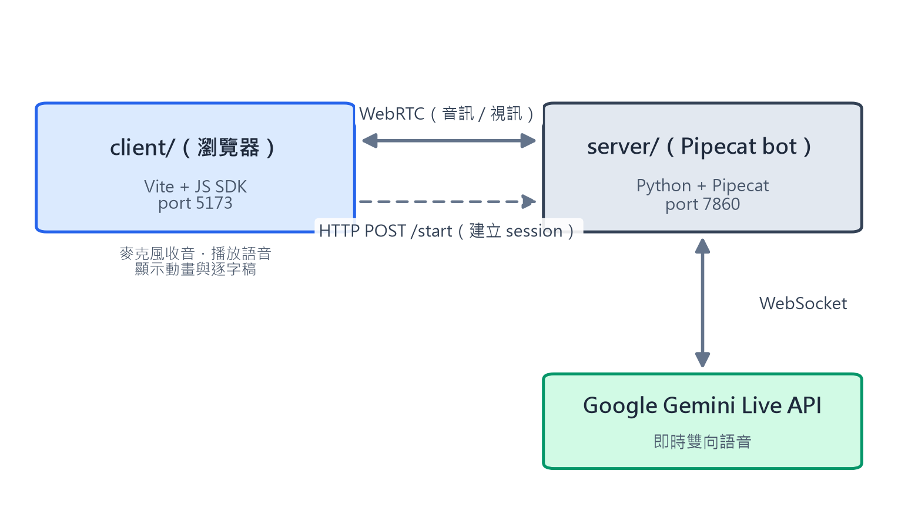
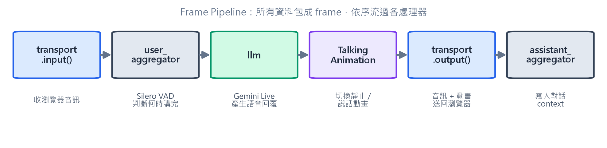
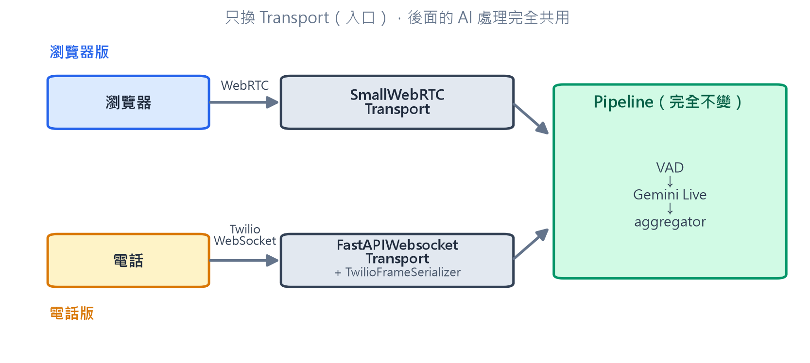

# 語音客服系統教學

從電話訂位、交換機架構，到 AI 語音機器人實作
（以 Pipecat Live Chatbot 專案為例）

# 一、前言：什麼是語音客服系統

「語音客服系統」指的是以語音為互動介面的自動化客戶服務：使用者用「說話」的方式提出需求，系統即時聽懂、處理，並用語音回覆。早期的語音客服是按鍵式的 IVR（互動式語音回應，「查詢餘額請按 1」），只能走預先設計好的選單；隨著大型語言模型（LLM）與即時語音 API 的成熟，現在的語音客服已經可以進行接近真人的自由對話——聽懂口語、理解意圖、即時回答，甚至在對話中完成訂位、查詢等實際任務。

本教材分成三大部分：

1. 觀念篇：語音訂位的目的是什麼？電話訂位和 APP 訂位有什麼本質差異？
1. 架構篇：一通電話是怎麼接到 AI 的？交換機（PBX）扮演什麼角色？
1. 實作篇：以實際專案「Pipecat Live Chatbot」為例，解析一個即時語音 AI 系統的完整架構與程式碼。

# 二、觀念篇：語音訂位的目的與價值

## 2.1 為什麼需要語音（電話）訂位？

以餐廳訂位為例，語音訂位系統的核心目的，通常不是取代 APP，而是接住「本來就打電話進來」的那群客人。電話訂位至今仍然非常大宗，原因包括：

- 許多客人（年長者、觀光客、臨時起意的人）不想安裝 APP、不想註冊會員，打電話最直覺，門檻為零。
- 有些需求本質上需要「談」：人數臨時多一位、想問有沒有包廂、輪椅或嬰兒車需求、食物過敏備註等，表單不容易表達。
- 用餐尖峰時段店家人力最忙，卻也是電話最多的時候——漏接電話等於直接流失生意。

**因此語音 AI 訂位的價值主要展現在店家端：**

- 24 小時不漏接來電，非營業時間也能受理訂位。
- 尖峰時段可同時接聽多通電話，不受人力限制。
- 自動把口頭資訊轉成結構化訂單（日期、時段、人數、聯絡方式）寫入系統。
- 可提供多語言服務，服務品質一致。

## 2.2 電話（語音）訂位 vs APP 訂位的本質差異

兩者的互動模式完全不同。關鍵差異在於：APP 是「使用者主動查詢、自行選擇」，語音則是「系統引導對話、逐項蒐集資訊」。

| **面向** | **語音／電話訂位** | **APP／網頁訂位** |
|----|----|----|
| 互動方式 | 對話式，一問一答 | 瀏覽式，自己看自己選 |
| 資訊呈現 | 線性，一次只能說一個時段 | 整個月曆、所有空位一眼看完 |
| 資料輸入 | 系統從對話中「抽取」日期、人數、姓名、電話 | 表單欄位，結構化輸入 |
| 錯誤處理 | 需要覆誦確認（「幫您確認：明天晚上七點四位，對嗎？」） | 使用者自己看到就會修正 |
| 協商彈性 | 高：「七點滿了，六點半可以嗎？」很自然 | 低：只能自己重新篩選 |
| 事後管理 | 較難（改期、取消要再打一次） | 容易（點幾下即可，還有提醒通知） |

這個差異也決定了技術重點的不同：做語音訂位系統，重點在「對話管理」——槽位填充（slot filling，把日期、時段、人數、聯絡方式一項項問齊）、聽錯時的修正、最後的覆誦確認；這些在 APP 上都不需要，APP 的重點則在介面與查詢體驗。

## 2.3 實務上的定位：多渠道共用同一套訂位系統

成熟的做法是讓兩者互補而非互相取代：APP 與語音 bot 共用同一套訂位系統，語音只是多開一個入口。



圖 1：多渠道共用同一套訂位系統

APP 服務願意自助的客人；語音 bot 接住打電話進來的客人；後端的空位資料是同一份。另外，實務部署常採「AI 先接、真人備援」：AI 處理一般訂位，遇到處理不來的狀況再轉接真人，這是目前餐廳訂位、客服系統最實際的上線方式。

# 三、架構篇：電話如何接進 AI —— 交換機與電話系統

## 3.1 整體路徑

語音 AI 本身只會處理「音訊串流」，但電話是走電信網路進來的，中間需要一層電話系統來銜接。完整路徑如下：



圖 2：一通電話接進語音 AI 的完整路徑

**關鍵觀念：電話通話一旦數位化，本質上就是「一路進、一路出的即時音訊流」，跟瀏覽器用 WebRTC 傳麥克風聲音是同一件事，只是入口從瀏覽器換成了電話網路。**

## 3.2 交換機（PBX）的角色

傳統所說的「交換機」（PBX，Private Branch Exchange，用戶交換機）負責三件事：

- 接聽與路由：電話進來後決定轉給誰——總機、分機、語音信箱，或是 AI 客服。
- 信令處理：建立、保持、掛斷通話。現代系統都使用 SIP（Session Initiation Protocol）協定。
- 媒體處理：把電話語音編碼收進來、送出去（電話常用 G.711 編碼、8kHz 取樣率）。

交換機的形態經歷了三代演變：

1. 傳統硬體 PBX：機房裡的實體交換機，接電信局的實體線路（類比線或 E1/T1）。要接 AI 得再加媒體閘道卡，昂貴且難整合，現在做語音 AI 幾乎不走這條路。
1. IP-PBX（軟體交換機）：用軟體實作交換機功能，跑在自己的伺服器上，代表作是開源的 Asterisk 與 FreeSWITCH。電信端改用 SIP Trunk（向電信業者申請，通話直接走網路進來，不需實體線路）。FreeSWITCH 可設定把通話音訊用 WebSocket 即時送給 AI 程式，是自建方案的主流。
1. 雲端電話平台（CPaaS）：如 Twilio、Telnyx、Vonage。完全不用碰硬體——在平台上租一個電話號碼，設定「來電時把音訊串流到我的伺服器」，電信、交換、媒體轉換全部由平台包辦。

## 3.3 主流做法：雲端平台（以 Twilio 為例）

現在建置 AI 電話客服，多數團隊選擇雲端平台，因為完全不需要自備交換機硬體。一通 AI 客服電話的流程如下：

1. 客人撥打你在 Twilio 租用的電話號碼（可租到台灣門號）。
1. Twilio 接起電話，依照設定發一個 HTTP 請求到你的伺服器，詢問「這通電話要怎麼處理」。
1. 你的伺服器回覆：「開一條 Media Stream，把通話音訊用 WebSocket 即時送到 wss://你的伺服器/...」。
1. 之後客人講的每一段聲音都變成 WebSocket 訊息流進你的程式；AI 產生的語音也從同一條 WebSocket 送回去，客人在電話裡就聽到了。

到了第 4 步，後面的處理就跟本教材實作篇的專案幾乎完全一樣——差別只在音訊的「入口」不同。

## 3.4 三種方案比較與混合部署

| **方案** | **硬體需求** | **適合情境** |
|----|----|----|
| 雲端平台（Twilio / Telnyx） | 無 | 快速上線、通話量不大、想專注在 AI 本身 |
| 自建 FreeSWITCH / Asterisk + SIP Trunk | 一台伺服器 | 通話量大想省成本、資料不想經過第三方 |
| 傳統硬體 PBX + 媒體閘道 | 實體交換機 | 幾乎只剩「公司已有舊 PBX 要整合」的場景 |

常見的混合情境：公司已有總機系統（既有 IP-PBX）時，不必打掉重練——在 PBX 上設定一條路由，把特定分機或「按 9 訂位」的來電用 SIP 轉送到 AI 服務，AI 處理不來時再轉回真人分機。

# 四、實作篇（上）：Pipecat Live Chatbot 專案總覽

## 4.1 專案簡介

本專案是用 Pipecat 框架搭建的即時語音聊天機器人：在瀏覽器用麥克風與 Google Gemini Live API 即時語音對話，畫面上還有一隻會隨著說話擺動的機器人動畫。前後端分離：後端跑 Pipecat pipeline（Python），前端是純 JavaScript（Vite）。

專案改寫自官方範例 pipecat-examples/simple-chatbot，主要精簡為：只保留 Gemini Live + WebRTC transport，拿掉 Daily transport（daily-python 沒有 Windows 版本）。因此本機測試不需要 Daily 帳號，只需要一把 GOOGLE_API_KEY。

| **層** | **技術** | **角色** |
|----|----|----|
| 前端 client/ | Vanilla JS + Vite + @pipecat-ai/client-js | 麥克風收音、播放 bot 語音與動畫、顯示逐字稿 |
| 傳輸 | WebRTC（SmallWebRTC） | 瀏覽器與後端之間的即時音訊/視訊串流 |
| 後端 server/ | Python + Pipecat | 組裝 frame pipeline：VAD、LLM、動畫 |
| AI 服務 | Google Gemini Live API | 即時雙向語音對話（直接聽語音、直接回語音） |

## 4.2 系統架構



圖 3：Pipecat Live Chatbot 系統架構

流程說明：

1. 前端先對後端發出 HTTP POST /start，建立一個 WebRTC session。
1. 之後音訊（使用者的麥克風聲音、bot 的回覆語音）與視訊（機器人動畫）都走 WebRTC 直連後端。
1. 後端收到使用者語音後，透過 WebSocket 串流到 Gemini Live；模型回覆的語音再串回瀏覽器播放。
1. 全程為即時雙向串流（streaming），而不是「錄好一段再送出」的回合制——這是低延遲對話體驗的關鍵。

## 4.3 目錄結構

```text
Pipecat-live-chatbot/
├── start.bat            # 一鍵啟動 server + client
├── stop.bat             # 停止所有服務
├── README.md
├── server/              # Pipecat 後端（Python / uv）
│   ├── bot-gemini.py    # 主程式：pipeline、Gemini Live、機器人動畫
│   ├── assets/          # 機器人動畫影格 robot01~025.png
│   ├── pyproject.toml   # 依賴（pipecat[google,runner,silero,webrtc]）
│   └── .env             # GOOGLE_API_KEY（勿進版控）
└── client/              # 前端（Vanilla JS / Vite）
    ├── index.html
    ├── src/
    │   ├── app.js       # PipecatClient 連線與 UI 邏輯
    │   ├── config.js    # transport 設定（預設 smallwebrtc）
    │   └── style.css
    └── .env             # VITE_BOT_START_URL
```

# 五、實作篇（中）：後端程式碼解析（server/bot-gemini.py）

## 5.1 核心概念：Frame Pipeline

Pipecat 的核心設計是一條「frame pipeline」：所有資料（音訊片段、文字、圖片、控制事件）都包成 frame，在一串 processor 之間依序流動，每個 processor 各司其職。本專案的 pipeline 如下：



圖 4：後端 frame pipeline 的六個處理階段

對應的程式碼（pipeline 組裝）：

```python
pipeline = Pipeline(
    [
        transport.input(),
        user_aggregator,
        llm,
        ta,                    # TalkingAnimation
        transport.output(),
        assistant_aggregator,
    ]
)
```

**教學重點：這種「管線＋處理器」的架構讓每個元件都可以獨立替換。例如想把瀏覽器入口換成電話入口，只需換掉 transport；想換 AI 模型，只需換掉 llm 元件；中間的 VAD、動畫等處理完全不用動。**

## 5.2 Transport 參數：宣告輸出視訊

```python
transport_params = {
    "webrtc": lambda: TransportParams(
        audio_in_enabled=True,
        audio_out_enabled=True,
        video_out_enabled=True,
        video_out_width=1024,
        video_out_height=576,
    ),
}
```

這裡宣告了 transport 的能力：收音訊、送音訊，同時輸出一路 1024×576 的視訊——這路視訊就是機器人動畫。

## 5.3 機器人動畫：影格載入

```python
sprites = []
for i in range(1, 26):
    full_path = os.path.join(script_dir, f"assets/robot0{i}.png")
    with Image.open(full_path) as img:
        sprites.append(OutputImageRawFrame(image=img.tobytes(),
                                           size=img.size, format=img.format))

# 加上反序影格，形成平滑的來回動畫
flipped = sprites[::-1]
sprites.extend(flipped)

quiet_frame = sprites[0]                    # 靜止影格（聆聽狀態）
talking_frame = SpriteFrame(images=sprites)  # 說話時的動畫序列
```

用 PIL 讀入 25 張 PNG 影格，正序加反序組成來回循環動畫。quiet_frame 是單張靜止影格（bot 聆聽時顯示），talking_frame 是整段動畫（bot 說話時播放）。

## 5.4 TalkingAnimation：自訂 FrameProcessor

這是自訂 pipeline 處理器的最佳範例——監聽「bot 開始／停止說話」事件，切換動畫狀態：

```python
class TalkingAnimation(FrameProcessor):
    def __init__(self):
        super().__init__()
        self._is_talking = False

    async def process_frame(self, frame: Frame, direction: FrameDirection):
        await super().process_frame(frame, direction)

        # bot 開始說話 → 切到動畫
        if isinstance(frame, BotStartedSpeakingFrame):
            if not self._is_talking:
                await self.push_frame(talking_frame)
                self._is_talking = True
        # bot 停止說話 → 切回靜止影格
        elif isinstance(frame, BotStoppedSpeakingFrame):
            await self.push_frame(quiet_frame)
            self._is_talking = False

        await self.push_frame(frame, direction)   # 原 frame 繼續往下傳
```

**教學重點：process_frame 檢查流過的每個 frame，遇到感興趣的事件（開始／停止說話）就額外推送影像 frame，最後一定要把原 frame 往下傳，否則 pipeline 會斷流。**

## 5.5 GeminiLiveLLMService：連接 Gemini Live

```python
llm = GeminiLiveLLMService(
    api_key=os.getenv("GOOGLE_API_KEY"),
    settings=GeminiLiveLLMService.Settings(
        model="models/gemini-3.1-flash-live-preview",
        system_instruction="You are Chatbot, a friendly, helpful robot. ...",
        voice="Charon",  # 可選：Aoede, Charon, Fenrir, Kore, Puck
    ),
)
```

- model：使用 Gemini Live 即時語音模型（speech-to-speech，直接聽語音、回語音，不需獨立的 STT/TTS 元件，延遲更低）。
- system_instruction：系統提示。特別要求「輸出不要包含特殊符號」，因為回覆會轉成語音。做訂位客服時，把角色、流程（問日期→問人數→覆誦確認）都寫在這裡。
- voice：語音音色，可依需求更換。

## 5.6 對話彙整與 VAD（語音活動偵測）

```python
context = LLMContext()
user_aggregator, assistant_aggregator = LLMContextAggregatorPair(
    context,
    realtime_service_mode=True,
    user_params=LLMUserAggregatorParams(
        vad_analyzer=SileroVADAnalyzer(),
    ),
)
```

- LLMContext：保存整段對話歷史，讓 bot 有上下文記憶。
- SileroVADAnalyzer：語音活動偵測（VAD），判斷使用者「何時開始講、何時講完」——這是語音對話系統的關鍵元件，決定了 bot 何時該接話。
- realtime_service_mode=True：配合 Gemini Live 這類即時語音服務的模式。

## 5.7 事件處理與開場

```python
# 先送一張靜止影格，讓視訊畫面立即出現
await worker.queue_frame(quiet_frame)

@worker.rtvi.event_handler("on_client_ready")
async def on_client_ready(rtvi):
    # 前端就緒後，主動塞一句開場指令，讓 bot 先自我介紹
    context.add_message(
        {"role": "developer", "content": "Start by introducing yourself."},
    )
    await worker.queue_frames([LLMRunFrame()])

@transport.event_handler("on_client_disconnected")
async def on_client_disconnected(transport, client):
    logger.info("Client disconnected")
    await worker.cancel()
```

on_client_ready 是「bot 主動開口」的技巧：前端連線就緒後，後端塞一則 developer 訊息並觸發 LLMRunFrame，bot 就會先自我介紹開場——訂位情境即為「您好，這裡是 XX 餐廳，請問要訂位嗎？」。

# 六、實作篇（下）：前端程式碼解析（client/src/）

## 6.1 config.js：transport 設定

```javascript
export const DEFAULT_TRANSPORT = 'smallwebrtc';

const botStartUrl =
  import.meta.env.VITE_BOT_START_URL || 'http://localhost:7860/start';

const smallWebRTCConfig = {
  endpoint: botStartUrl,          // 後端建立 session 的端點
  requestData: {
    createDailyRoom: false,
    enableDefaultIceServers: true,
    transport: "webrtc",
  },
};

export async function createTransport(transportType) {
  switch (transportType) {
    case 'smallwebrtc': {
      const { SmallWebRTCTransport } =
        await import('@pipecat-ai/small-webrtc-transport');
      return new SmallWebRTCTransport();
    }
    // ...
  }
}
```

後端位址由環境變數 VITE_BOT_START_URL 控制（預設 http://localhost:7860/start）。createTransport 使用動態 import，只載入實際會用到的 transport 函式庫。

## 6.2 app.js：VoiceChatClient 連線流程

前端核心是 VoiceChatClient 類別，使用官方 SDK 的 PipecatClient 處理連線與事件：

```javascript
const transport = await createTransport(this.transportType);

this.client = new PipecatClient({
  transport,
  enableMic: true,          // 開啟麥克風
  enableCam: false,         // 不需要使用者視訊
  callbacks: {
    onConnected: () => this.onConnected(),
    onDisconnected: () => this.onDisconnected(),
    onBotReady: () => this.addEvent('bot-ready', 'Bot is ready to talk'),
    onUserTranscript: (data) => {          // 使用者語音逐字稿
      if (data.final) this.addConversationMessage(data.text, 'user');
    },
    onBotTranscript: (data) => {           // bot 回覆逐字稿
      this.addConversationMessage(data.text, 'bot');
    },
    onError: (error) => this.addEvent('error', error.message),
  },
});

await this.client.startBotAndConnect(connectParams);
```

- startBotAndConnect：先 POST /start 請後端建立 session，再建立 WebRTC 連線，一行完成。
- onUserTranscript / onBotTranscript：即時逐字稿事件，讓畫面同步顯示對話文字（客服情境中即為「通話紀錄」）。

## 6.3 app.js：接收 bot 的音訊與視訊軌

```javascript
this.client.on(RTVIEvent.TrackStarted, (track, participant) => {
  if (!participant?.local) {
    if (track.kind === 'audio') {
      // bot 的語音：建立 <audio> 元素自動播放
      const audio = document.createElement('audio');
      audio.autoplay = true;
      audio.srcObject = new MediaStream([track]);
      document.body.appendChild(audio);
    } else if (track.kind === 'video') {
      // bot 的動畫視訊：掛到畫面上的 <video> 元素
      this.setupVideoTrack(track);
    }
  }
});
```

WebRTC 連線建立後，bot 的語音與動畫是兩條媒體軌（track）。前端監聽 TrackStarted 事件，音訊軌接到 <audio> 自動播放，視訊軌（機器人動畫）掛到畫面上的 <video> 元素。participant?.local 的判斷是為了排除自己的本地軌，只處理遠端（bot）的軌。

## 6.4 執行方式

一鍵啟動（Windows）：在專案根目錄執行 start.bat，會分別啟動：

- server → http://localhost:7860（自動設 PYTHONUTF8=1 避免編碼錯誤）
- client → http://localhost:5173

啟動後開瀏覽器到 http://localhost:5173，按 Connect、允許麥克風權限即可開始對話。停止則執行 stop.bat。手動啟動：server 目錄下 uv run bot-gemini.py；client 目錄下 npm run dev。

**注意：server/.env 內含真實 API 金鑰，若要公開分享程式碼，務必將 .env 加入 .gitignore 並重新產生金鑰。**

# 七、延伸：把這個專案變成真正的電話訂位客服

本專案目前的入口是瀏覽器（WebRTC），但如架構篇所述，電話進來的通話最終也是一條音訊流。要把這隻 bot 變成能「接電話」的訂位客服，需要兩個改造：

## 7.1 改造一：換上電話 transport

Pipecat 內建 Twilio、Telnyx 等 telephony transport。把 SmallWebRTCTransport 換成 WebSocket transport + 對應平台的 serializer，pipeline 中的 VAD、Gemini Live、aggregator 全部原封不動：



圖 5：換上電話 transport，pipeline 完全共用

唯一的差別是電話沒有畫面，機器人動畫（TalkingAnimation 與視訊軌）在電話版中沒有作用，可以拿掉。

## 7.2 改造二：用 Function Calling 串接訂位系統

要讓 bot 真的能訂位，而不只是聊天，要給 LLM 定義「工具」（function calling）：

```python
# 概念示意
tools = [
    check_availability(date, time, party_size),   # 查詢空位
    create_reservation(name, phone, date, time, party_size),  # 建立訂位
]
```

對話流程即為觀念篇所述的槽位填充：bot 逐項問齊日期、時段、人數、姓名、電話，呼叫 check_availability 查空位；若客滿則協商替代時段；確認後呼叫 create_reservation 寫入訂位系統——與 APP 走同一套後端 API，實現「多渠道、同一套訂位系統」。

# 八、總結

1. 電話訂位至今仍是主流管道之一；語音 AI 客服的目的是把這條管道自動化，與 APP 互補而非取代。
1. 語音互動是「對話引導、逐項蒐集」，APP 是「自助瀏覽、表單輸入」，因此語音系統的技術重點在對話管理（slot filling、覆誦確認、錯誤修正）。
1. 「交換機」概念上仍然需要，但今天多半不是硬體，而是雲端電話平台（CPaaS）或軟體交換機（FreeSWITCH / Asterisk）；它的工作是把電信通話變成即時音訊流。
1. Pipecat 的 frame pipeline 架構把 transport、VAD、LLM、動畫拆成可獨立替換的元件——同一條 pipeline，換個 transport 就能從「瀏覽器語音助理」變成「電話客服」。
1. Gemini Live 這類 speech-to-speech 即時模型省去獨立 STT/TTS，是低延遲語音對話的關鍵；配合 function calling 即可完成實際的訂位任務。
